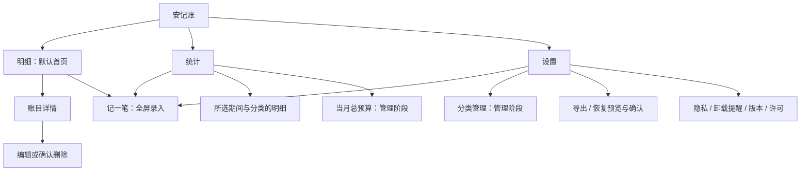

# 安记账项目方案 v1.0

> **For agentic workers:** REQUIRED SUB-SKILL: Use subagent-driven-development or executing-plans to implement this plan task-by-task. Steps use checkbox (`- [ ]`) syntax for tracking.

**Goal：** 在已验收的 0.1.2 基础上，形成中文、离线、单账本的安卓记账工具：日常录入顺手，明细容易查，收支结构看得懂，数据能够可靠备份和迁移。

**Architecture：** 保留单 Activity、Compose Material3、StateFlow、纯 Kotlin 业务规则、SQLiteOpenHelper 和系统文件选择器。先拆分界面职责，再扩展统计；分类库与预算集中到一个显式数据库迁移阶段，并同时升级备份合同。

**Tech Stack：** Kotlin 2.1.20、AGP 8.9.2、Compose BOM 2025.04.01、Material3、Lifecycle 2.8.7、Coroutines 1.10.2、Android SQLite、org.json；继续使用 JUnit / Robolectric / Compose UI Test。

**方案日期：** 2026-10-05（Asia/Shanghai）。**状态：** 建议稿，供作者审阅；方案 v1.0 是文档版本，当前应用仍为 0.1.2。本次没有实现新功能、升级依赖或发布 APK。

## 全局约束

- Android 8.0 / API 26 及以上；默认 CNY 人民币；单账本。
- 首版本地存储，不添加 INTERNET 权限、广告、遥测、第三方分析、云同步。
- 金额用整数分，禁止浮点数参与账目计算；校验输入、日期、金额边界。
- 单笔金额 0.01 至 999999999.99 元；分类修剪后 1 至 20 字符；备注最多 200 字符；记录年份 1900 至 9999。
- 数据库保存在应用私有目录；关闭自动云备份，导出时说明明文账本风险。
- 备份文件必须有格式版本；恢复先完整验证，再以数据库事务执行；取消、损坏或不兼容文件不得破坏现有账目。
- 导入默认合并，以稳定记录 ID 去重；同 ID 内容冲突不得静默覆盖。
- 升级不得以破坏性重建数据库代替迁移。卸载会删除应用私有数据，验收前先导出备份。
- 技术测试、作者手机验收和正式商店发布分别记录；正式签名与商店发布另行决定。
- 本文是下一轮范围建议。原已确认首版范围和安全规则继续有效；新增分类库、预算及备份 v2 须经作者确认相应阶段后实施。

---

## 1. 产品判断与目标用户

建议将安记账定位为“无需注册、打开就能记、数据由自己保管的日常收支账本”。优先服务个人日常消费记录、简单工资收入管理和每月支出复盘。它需要让用户顺利完成四件事：记一笔、找一笔、看懂这个月、保存并迁移自己的数据。

成熟记账产品的可借鉴价值主要在这些任务的组织方式。安记账当前基础适合把这四条路径做完整，再逐步增加管理能力。首轮不进入资产负债、企业会计、支付账单采集或家庭协作。

建议的产品成功信号是作者连续使用 7 天，并能独立完成录入、查账、月度复盘和导出恢复；数据零丢失、错误输入不保存、保存失败保留草稿、每项合并结果可解释。七天试用是建议的验收方法，尚未执行。

## 2. 当前基础与实际差距

本次实读本地 `main`，HEAD 为 `ff8479f75cd917bc49e5ab2173ad7e9906dc480c`，开始时工作区干净。以下以当前代码及交接记录为依据；历史测试通过是已有文档证据，本次没有重跑应用测试。

| 模块 | 0.1.2 已有能力 | v1.0 方案如何承接 |
|---|---|---|
| 收支 | 新增、编辑、确认删除；日期、分类文本、备注；整数分金额 | 保留数据规则，改为金额优先的全屏录入；明细进入详情后编辑/删除 |
| 分类 | 支出 5 个、收入 3 个建议项；可以自由输入名称 | 先改善选择交互；后续增加一层分类库、隐藏和排序 |
| 明细 | 所选月列表；分类/备注字面搜索；收支 AND 筛选 | 按日期分组、压缩条目高度、显示筛选范围、保留已验收搜索语义 |
| 统计 | 整月收入/支出/结余；支出分类金额及比例条 | 增加收入分类、年度 12 个月概览、分类明细钻取 |
| 存储 | 私有 SQLite，schema 1，稳定 UUID；加载全量记录到 StateFlow | 保留账目表；分类/预算阶段新增表并做 1→2 迁移 |
| 备份 | JSON format 1；最多 50000 条 / 10 MiB；事务合并；重复跳过、内容冲突拒绝 | 先保留现状；有配置数据后使用 format 2，仍读取旧 format 1 |
| 安全 | Manifest 无联网/广泛存储权限；关闭系统自动备份 | 维持同样边界；不把本地私有目录误称为数据库加密 |
| 验证 | 文档记录 50 项 JVM、10 项 UI 及旧版升级测试通过；作者确认 0.1.2 通过 | 新功能建立自己的证据，不继承历史结果作为新验收 |

当前主要问题来自源码结构和布局：`LedgerScreen.kt` 同时处理导航、明细、统计、设置与编辑状态；每条记录重复日期与操作按钮；`EntryEditor.kt` 是较长的对话框表单；统计只有支出分类，导航使用文字代替图标。上述是代码审阅判断，手机上的具体拥挤程度仍需新界面实机验证。作者手机型号和 Android 版本尚未提供。

## 3. 市面功能参考与采用决定

调研日期为 2026-10-05。下表来自实际打开的官网、官方帮助或官方发布者页面；未安装竞品，未核验付费价格。只参考任务分层和交互原则，不复制竞品截图、品牌、文案或源码。

| 产品与直接来源 | 来源可确认的特点 | 安记账采用的思路 |
|---|---|---|
| [钱迹官网](https://qianjiapp.com/) / [主界面帮助](https://docs.qianjiapp.com/home/) / [分类管理](https://docs.qianjiapp.com/fen-lei-guan-li.html) / [预算](https://docs.qianjiapp.com/vip/vip_budget.html) | 快捷记账，流水与报表入口，分类排序，总预算和分类预算；[云同步帮助](https://docs.qianjiapp.com/yun_tong_bu.html)说明注册后的服务器同步 | 缩短录入路径；分类选择明确；统计独立。其“最少三步”是宣传声明，本方案不承诺未验证的操作速度 |
| [鲨鱼记账官网](https://www.shayujizhang.com/) | 极简记账、统计、月度及分类预算、搜索、Excel 导出、提醒和同步等 | 简化操作；月预算作为单独增量。官网不能证明具体安卓底部导航或备份冲突处理方式 |
| [随手记官方发布者页面](https://apps.apple.com/cn/app/id372353614) | 快捷录入、首页报表、流水、账户、预算、多账本与多人协作等 | 明细顶部先看概况，录入突出金额区域。此来源是 iOS 页面，仅参考产品思路 |
| Money Manager [安卓 Home tab 帮助](https://help.realbyteapps.com/hc/en-us/articles/360046150874-Home-tab) / [Stats Tab 帮助](https://help.realbyteapps.com/hc/en-us/articles/360045310273-Stats-Tab) | 交易与统计任务分离；收入/支出分类统计；切换月份及进入分类详情 | 明细/统计分离；点击分类查相关记录。部分帮助较旧，不能视作当前版本布局实测 |

由这些来源可以支持“快速录入、明细与统计分开、分类可管理、预算帮助控制支出”的需求方向。选择三个导航、预算先做月总额、保留单账本，是针对安记账工程规模作出的设计判断，不能归因于竞品原样实现。

## 4. 推荐范围与取舍

| 优先级 | 范围 | 用户价值 / 实现代价 |
|---|---|---|
| P0：第一阶段必须 | 三主入口、全局记一笔、日期分组明细、详情页、全屏编辑、搜索筛选保留、备份入口清楚、浅深主题 | 高频路径改善最大；可先不动数据库和备份格式 |
| P1：统计阶段 | 收入/支出分类切换、年度概览、类别排行、精确分类钻取 | 使用现有账目字段即可；增加统计逻辑与 UI 测试 |
| P1：单独确认的管理阶段 | 一层分类库：新增/隐藏/排序；按月设置总支出预算；完整配置备份与恢复预览 | 日常可用性提升；必须承担 schema 2 / format 2 的迁移成本 |
| P2：后续候选 | CSV 导出、跨月全局搜索、周期记录、桌面快捷记账、分类预算、应用锁、加密备份 | 各自有额外合同和测试；不占用本方案首轮范围 |
| 本方案不纳入 | 多账本、多账户/转账、信用卡/借贷、多人同步、联网 AI/OCR、支付平台导入、短信/通知/无障碍采集、照片附件、广告、遥测 | 引入新数据关系、权限、服务器或敏感数据处理；目前收益不足以覆盖复杂度 |

明细顶部的“结余”始终表示所选月份的收入减支出，不命名为“账户余额”或“资产”。没有账户模型时，收支结余不能代表用户实际拥有多少钱。

## 5. 功能拓扑与页面设计

主导航采用 **明细 / 统计 / 设置**。记账是一个动作，不占独立导航页；在三个主页面均提供右下方“＋ 记一笔”按钮。编辑器、详情页和确认弹窗出现时隐藏该全局按钮，避免重入。

Android 官方建议底部导航用于 3–5 个同等重要的主要目的地；当前三入口可以继续使用现有 `NavigationBar`，无需为了这次拆页引入导航框架。[官方导航组件说明](https://developer.android.com/develop/ui/compose/components/navigation-bar)



### 5.1 明细

顶部显示月份选择、收入/支出/结余。点击月份打开月选择器，保留上月/下月和回到本月操作，年份边界继续为 1900–9999。

明细按日期倒序分组；日期组头只显示日期和可见条数。条目显示分类、可选备注摘要和带正负号的金额，金额右对齐。整行点击进入详情；编辑与删除放入详情，删除继续二次确认。首轮不增加滑动删除，以减少误触和额外手势学习。

搜索默认限定当前月份，关键词匹配分类或备注，保持 trim、ignoreCase、字面子串和收支 AND 规则；`%`、`_`、`.` 不成为通配符。清除同时清空关键词与类型，月份不变。显示“显示 N / 本月 M 条”，筛选时明确“统计为整月”。空月份与有记录但无匹配分开提示。

顶部总计始终来自完整所选月，不能被搜索或类型筛选改变。切换主页面、切月及 Activity 重建保留原搜索输入和类型；不承诺强制停止后的长期查询记忆。

### 5.2 记一笔与编辑

使用全屏编辑界面：顶部取消与标题，主体为收支切换、突出显示的金额、分类网格，日期默认今天，备注折叠为次要输入。日期仍允许选择器和有效日期输入；展开的备注与保存操作始终可滚动到，不被键盘遮挡。

先沿用系统数字键盘，金额使用现有 `Money.parse`；首轮不制作带表达式计算的自定义键盘。默认选择“支出”，新记录不预填金额；编辑加载原内容。分类未选择时保存给出明确提示，不静默归入“其他”。最近使用分类从账目派生，每种类型最多展示 6 个，按日期降序、同日 ID 稳定顺序取首次出现的去重名称；这里的“最近”按账目日期，不能声称是创建时间。

保存过程中禁用重复提交，收到匹配的 operation ID 成功结果后才返回；失败保留全部输入。未保存的改动点击返回/取消时询问是否放弃；保存成功无需再询问。保持 Activity 重建后的草稿、待完成操作 ID 与结果消费逻辑；进程被系统终止后的草稿恢复不列为本轮保证。

### 5.3 统计

提供月度和年度切换。月度：完整月份的收入、支出、结余；收入/支出分类切换；按金额降序的排行与横向比例条。年度：所选年 12 个月的收入/支出柱形概览、全年总计、全年类别排行。默认当前月/当前年；无记录月份显示 0，不省略。

列表同时显示准确金额和比例，金额排序相同时按分类名稳定排序。无金额时不计算百分比；百分比可用 `BigDecimal` 进行显示舍入，图形坐标可用浮点比例，但不回写或计算账目金额。零收入时不显示“储蓄率”，本方案不增加这项指标。

点击分类排行进入独立的分类明细，限定所选月或年、收支类型及**修剪后的精确分类名**；不借用关键词子串查询。返回统计恢复期间与位置，原明细页的搜索不被钻取覆盖。

先实现排行和条形/柱形图，不加入饼图、折线交叉手势、导出图片或复杂动画。图形都附带同一数据的文字金额，不能只靠颜色阅读。

### 5.4 分类管理

位于设置中，按支出/收入分开。初始分类延续现有建议项，并从已有记录修剪后的分类名补全；所有历史账目本身保持原样。提供新增、隐藏/重新显示及“上移/下移”排序，首轮不做拖拽排序。

分类身份是 `(kind, name.trim())`，大小写敏感，不做繁简转换或 Unicode 规范化；两个类型的“其他”是不同分类。名称仍为 1–20 字符。同类型同名称不能新增重复。隐藏只影响新记录的选择网格，历史记录仍显示原分类；编辑历史记录可以保留原分类，包括被隐藏或未注册的名称。

首轮不做“改名并修改历史账目”或硬删除分类。如需换名字，新增新分类并隐藏旧分类，旧统计保持可追溯。记账时继续允许输入自定义名称，保存成功后在同一事务补入分类库；已隐藏的同名项不会被保存账目自动解除隐藏。

### 5.5 月预算

预算放在月统计页，设定的是**该月份的总支出上限**，并非资产余额。每月独立，没有设置时显示“未设置预算”，不当作预算 0；首轮不自动沿用上月，不限制记账、不发通知。

预算金额使用整数分，范围 0.01–999999999.99 元。展示已支出、预算、剩余；超出时展示明确的“超出 ¥X”，保留准确超出值，图形进度最高显示 100%。新增、编辑或删除该月支出后即时更新；收入不改变预算消耗。清除预算只删除该月设置，不影响账目。

### 5.6 设置、备份与错误处理

设置包含分类管理、备份恢复、本地隐私、卸载提醒、版本及完整第三方许可证，不设置无实际功能的登录/会员/云同步入口。

导出是整本账目及管理配置，与页面筛选无关。选择位置前显示明文风险和容量边界；读写成功并关闭输出流后才显示成功。导出失败不能声称生成有效备份；提示新文件可能不完整，保留旧备份与当前数据库。系统文件提供者可能包含第三方云盘，应用不自行上传；提醒用户选择可信位置。文件选择器不要求广泛存储权限。[Android SAF 官方说明](https://developer.android.com/training/data-storage/shared/documents-files)

管理阶段增加恢复预览：显示文件格式、账目新增/重复/冲突数量及配置处理结果，再由用户确认合并。预览不是写入；取消、旋转、读取失败、后台进程结束都不能自动执行恢复。成功后显示实际事务结果；有账目冲突时说明未导入并保留原数据，错误日志不打印金额、备注或完整备份。

同一设备上的备份不能覆盖设备遗失风险，建议用户另存到自己可信的第二个位置；这是保管提示，不构建自动同步。[Money Manager 官方备份说明](https://help.realbyteapps.com/hc/en-us/articles/360042747934-How-to-backup-and-restore-data)

## 6. 视觉与可用性要求

保留现有深青主色与中文系统字体，整体采用清楚的数字层次和紧凑账目行。收入/支出同时用文字、正负号与颜色区分。导航替换为语义图标加文字，不使用“账/计/设”作为图标；不加载远程字体、图片或主题。

浅色与深色主题跟随系统，金额、分割线、输入错误状态分别核对对比度。主要金额约 28–32sp，正文 16sp，辅助文字 14sp；这些是初始设计值，不能以固定字号掩盖布局问题。

可点击区域至少 48dp；在 360dp 宽屏、系统字体 1.0/1.3/2.0 倍、中文长分类/备注、系统键盘打开时检查布局。2.0 倍可调整为纵向布局或滚动，不允许保存、导航或删除确认被裁掉。图标按钮提供语义描述，图表配文字清单，并验证 TalkBack 能阅读记录及进入编辑。[Compose 无障碍官方说明](https://developer.android.com/develop/ui/compose/accessibility)

## 7. 安全复用清单

“安全可复用”是有来源、许可和采用边界的决策，不是对网上代码作安全保证。此次只调查，不下载第三方脚本、不引入新依赖。

| 候选 | 来源 / 许可与固定方式 | 决定与代价 |
|---|---|---|
| 已有 Compose Material3 / Lifecycle | [AndroidX 官方仓库](https://android.googlesource.com/platform/frameworks/support/) / [Apache-2.0 LICENSE](https://github.com/androidx/androidx/blob/androidx-main/LICENSE.txt)；继续仓库已固定的 BOM 2025.04.01、Lifecycle 2.8.7 | 采用现有 API，完成导航、表单、选择器与主题；官方最新示例须在当前版本实际编译，不能默认升级 |
| Compose 图形 API | [官方绘制文档](https://developer.android.com/develop/ui/compose/graphics/draw/overview)；现有 Compose 依赖；文档和代码示例许可须区分 | 采用公开 API 自行实现少量柱形/比例条；不复制整段文章。开发成本低，需自行补语义和零值测试 |
| Google Material Symbols 静态图标 | [官方仓库](https://github.com/google/material-design-icons)；[固定提交 Apache-2.0 LICENSE](https://github.com/google/material-design-icons/blob/737e3324305806514d7909874fa1818ae1808232/LICENSE) | 拟采用少量导航/操作图标，候选 SHA 为 `737e3324305806514d7909874fa1818ae1808232`；实施时逐文件核对来源、哈希并转为本地向量。尚未下载或集成；保留完整许可与 NOTICE |
| SAF 与状态保存公共 API | [SAF](https://developer.android.com/training/data-storage/shared/documents-files) / [Compose 状态保存](https://developer.android.com/develop/ui/compose/state-saving) | 继续已有 CreateDocument/OpenDocument、rememberSaveable 和 ViewModel；无需联网或广泛存储权限。不把全账本塞入 SavedState |
| MoneyBook MIT 片段 | [已有审计的固定源码](https://github.com/AndersOnLin4/moneybook/tree/98c50341da262e839f68557e721eee38aca57067) / [MIT LICENSE](https://github.com/AndersOnLin4/moneybook/blob/98c50341da262e839f68557e721eee38aca57067/LICENSE) | 继续项目已采用的金额解析片段与完整许可；不新增复制其搜索、Room、通知或整个应用模块 |
| Vico 图表库 | [官方项目](https://github.com/patrykandpatrick/vico) / [已核验 v3.3.1](https://github.com/patrykandpatrick/vico/releases/tag/v3.3.1) / [该版本 Apache-2.0 LICENSE](https://github.com/patrykandpatrick/vico/blob/v3.3.1/LICENSE) | 当前不采用。简单图表不需要额外版本和绘图兼容成本；若以后需要交互图表，重新固定版本、审查许可及做 API26/35 回归 |

官方文档的文字一般按其内容许可使用，示例代码按页面注明的代码许可处理；库许可证不自动覆盖文档正文或品牌素材。[Android 内容许可](https://developer.android.com/license)

GPL/AGPL 账本项目只可作为本轮产品研究对象，不把其代码或资源引入私有闭源交付。开源仓库的 README、截图和图标也不因公开可见而自动允许复制。每个实际采用的新增文件在复用审计中记录来源 URL、固定 SHA/版本、许可证、修改、SHA-256、依赖与权限检查结果；完整许可证随 APK 保留。

分类图标仅作为显示映射，已知名称使用本地图标，未知或自定义分类使用通用图标；首轮不增加自选图标字段，也不为了匹配图标修改历史类别。新增资源集成前确认固定文件仍适用，其维护状态不能代替安全与兼容验证。

## 8. 数据合同、迁移与备份兼容

### 8.1 保持账目合同

`Entry(id, kind, amountCents, category, date, note)` 保持字段与含义；UUID 不重生成；不改动旧账目金额、日期、备注及分类原文。统计与精确分类筛选统一通过 Kotlin `trim()` 取分类键，避免 SQLite `TRIM` 字符集合不同导致钻取漏记录。

详情页面以稳定 ID 查找当前账目，不能把进入时的快照一直当作最新数据；记录已不存在时给出“这笔账目已不存在”及返回操作，不创建同 ID 的空记录。

S1/S2 保持 schema 1 与 format 1。S1 先将编辑/删除的界面状态从 `BackupCodec.encode/decode` 单记录用法解耦：只保存必要的原始字段、记录 ID、草稿和待完成操作 ID。外部备份格式变化不能改变草稿恢复行为，SavedState 中不能保存完整账本。

### 8.2 管理阶段的 schema 2

保留 `entries` 原表，新增以下两张表；建库与迁移必须产生相同结构。

| 表 | 字段与身份 | 规则 |
|---|---|---|
| `categories` | `kind TEXT`、`name TEXT`、`sort_order INTEGER`、`hidden INTEGER`；主键 `(kind,name)` | kind 仅 INCOME/EXPENSE，name 是 Kotlin 修剪后 1–20 字符，排序 0–2147483647，hidden 0/1；同排序按名称稳定排序 |
| `monthly_budgets` | `month TEXT PRIMARY KEY`、`limit_cents INTEGER` | month 严格 `yyyy-MM` 且年月有效、年 1900–9999；金额 1–99999999999 分；无行表示未设预算 |

分类库不作为旧账目的强制外键；历史记录可有隐藏或未注册分类。预算只按月份关联查询，不修改任何 Entry。

显式 1→2 迁移新增表，再在同一迁移事务内以现有默认分类与历史记录修剪后的 `(kind,name)` 去重初始化类别；排序按默认项优先、其他名称稳定排序。预算初始为空。任何一步失败必须回滚，不删除账目表，不捕获异常后继续假装成功。schema 2 的新安装直接创建三张表并初始化默认类别。

### 8.3 format 2 的明确结构

format 2 根字段固定为 `format/version/currency/entries/categories/budgets`；format 固定 `an-jizhang`，version 为整数 2，currency 固定 CNY。entries 保留 format 1 全部字段；categories 每项固定 `kind/name/sortOrder/hidden`，其中 hidden 为 JSON 布尔；budgets 每项固定 `month/limitCents`。不导出临时查询、页面位置、草稿或签名信息。

备份 UTF-8 总大小继续最多 10 MiB；entries 最多 50000 项，categories 最多 50008 项（50000 个历史独立类别加现有 8 个默认项的最坏联合集），budgets 最多 97200 项（有效年份范围内的月份数）。类别上限检查的是输入类别与 Entry 派生缺失类别的归一化联合集，不仅是输入数组长度；超过任一限制即整体拒绝，不截断导出或补齐。

预览与确认都检查合并后的完整快照：最终条数或 UTF-8 编码大小超过上述上限时，整批拒绝恢复并说明原数据保留。这是新增的合并后容量保护，旧格式也适用，避免恢复成功后立刻无法备份。保存账目没有同等总量限制，因此数据库仍可能存在可查看但不可完整导出的状态；已有超限数据库升级时保留全部账目与类别、公开提示，不能靠迁移截断或删除解决。管理信息也占字节容量，即使旧 format1 能导出，也不能保证加上配置的 format2 仍小于10MiB；更大备份或分批归档另立方案。

严格 JSON 语法、重复字段、字段类型、未知字段、重复记录 ID、重复分类键、重复预算月份、年月/金额/长度边界都先验证。格式版本独立于应用版本与 schema 版本，不能假设三者数值相同。

| 输入 / 场景 | 新版本行为 |
|---|---|
| 旧 format 1 | 继续读取；按稳定 ID 去重并检查冲突，适用新增的合并后容量保护；补入缺失分类；本机预算和既有分类设置不变 |
| format 2 → 初始空账本 | 使用备份分类替代未修改的默认分类种子，再合并账目和预算；保留输入配置的顺序/隐藏状态；从账目补齐缺失类别 |
| format 2 → 有数据 | Entry 同 ID 同内容跳过、不同内容整批拒绝；分类相同键配置不同时保留本机并报告；预算相同月份金额不同时保留本机并报告；不存在的键新增 |
| 未知版本、字段非法、内容损坏或超限 | 完整拒绝，数据库三张表均不变 |
| format 2 交给 0.1.2 | 旧版不支持，必须说明；不承诺反向导入或降级 |

配置冲突采用“本机优先”是本方案明示规则，预览和结果必须列出保留本机的数量，不得显示成配置全量还原。若备份含被隐藏类别，恢复其账目时不能自动解除隐藏。分类和预算始终与账目在同一导入事务中提交或回滚。

“初始空账本”严格定义为 entries 和 budgets 都为空、categories 的完整列表、排序和隐藏状态与应用规范默认种子逐项完全相同。当前配置与种子不同就按有本机配置的合并规则处理，即使没有账目；本方案不追踪用户曾修改后又还原的历史。预览明确显示“将用备份分类替代默认分类”，确认事务再次检查这一模式，替代后只补齐 Entry 缺失的类别，不重新初始化默认种子覆盖备份设置。format1 不触发替代种子的行为。

导出三张表时在同一数据库读事务中构造一致快照，再释放事务进行验证与文件写入；不能分别读取不同时间的账目和配置。写入期间的新修改不进入已生成快照，导出结果标明这是开始读取时的数据。

预览持有已严格验证的暂存快照，不在确认时重新读取可能变化的 URI。所有业务写入由同一 ViewModel 串行协调，每次成功修改账目、分类或预算递增会话修订号；token 绑定预览时的修订号。任何相关修改都使旧预览失效，不仅比较数量或冲突数量。确认时在同一事务内重验修订号、初始空账本模式、当前内容冲突和最终容量，变化时停止写入并要求重新预览。进程被终止后取消暂存操作，重新选择文件；不保存 URI 并在重启后自动导入。

## 9. 文件职责与接口边界

以下列出已有文件的职责调整及拟新增文件，新增部分尚未创建或实现。已有代码遵循小应用直接依赖注入，不增加 Hilt、Room、网络客户端或图片加载器。

| 位置（项目根目录下） | 计划职责 |
|---|---|
| `ui/LedgerScreen.kt` | 保留 MainActivity 入口签名，收集状态并组合页面；移出大段明细/统计/设置布局 |
| `ui/LedgerListPage.kt`、`StatisticsPage.kt`、`SettingsPage.kt` | 只渲染各自页面，不直接操作 SQLite 或文件流 |
| `ui/LedgerNavigationState.kt` | 三主页面、月份、关键词/类型、详情 ID 与分类钻取上下文；保存必要原始值 |
| `ui/EntryDetail.kt`、`EntryEditor.kt`、`EntryEditorState.kt` | 稳定 ID 详情、全屏录入与独立草稿状态；保留匹配操作结果消费 |
| `ui/LedgerCharts.kt`、`Theme.kt` | 简单柱形/条形图、文字语义与浅深色 token |
| `domain/CategoryStatistics.kt`、`AnnualSummary.kt` | 月/年收支类别与年度十二月数据，金额安全加减；不持有 Android Context |
| `domain/CategoryDefinition.kt`、`Budget.kt`、`BudgetSummary.kt` | 分类身份/规则、年月预算与剩余/超出计算 |
| `data/LedgerDatabase.kt` | schema2 建库/迁移；分类/预算访问；全快照事务合并 |
| `data/BackupSnapshot.kt`、`BackupCodec.kt` | v1/v2 严格解码、配置验证、完整快照导出与预览结果模型 |
| `ui/CategorySettingsPage.kt`、`BudgetEditor.kt`、`RestorePreview.kt` | 管理阶段的分类操作、预算编辑、恢复预览确认 |
| `ui/LedgerViewModel.kt`、`MainActivity.kt` | 后台 I/O 和串行修改；系统选择器入口；暂存恢复 token 的生命周期 |

上述 `ui/domain/data` 均位于 `app/src/main/java/com/xiaoliumiaomiao/anjizhang/`。测试对应放到 `app/src/test/java/com/xiaoliumiaomiao/anjizhang/` 与 `app/src/androidTest/java/com/xiaoliumiaomiao/anjizhang/`，沿用现有目录结构。

关键接口合同如下，实施时按该职责补充代码，不跨任务暗中改变类型含义：

- 保留 `EntryFilter.apply(entries, month, query, kind)` 兼容旧调用；分类钻取使用独立的期间与精确类别筛选，不改变其字面搜索合同。
- `CategoryStatistics.calculate(entries, startInclusive, endExclusive, kind)` 输出按金额降序的 `(category, amountCents)` 列表；类别是统一 trim 后的名称，边界为 `LocalDate` 左闭右开。
- `AnnualSummary.calculate(entries, year)` 输出全年 income/expense/balance 与按 1–12 月顺序的十二项 `MonthlySummary`；year 为 1900–9999。
- `BudgetSummary.calculate(expenseCents, limitCents)` 接受非负支出 Long 与可空预算 Long；输出未设置或已设置状态、带符号 remainingCents 和非负 overspentCents，使用精确整数运算。
- `BackupCodec.decodeSnapshot(text)` 输出 `BackupSnapshot(entries, categories, budgets, formatVersion)`；format1 的配置列表为空，format2 按新合同解码。
- `LedgerDatabase.mergeSnapshot(snapshot)` 输出账目新增/跳过、分类新增/保留本机、预算新增/保留本机计数，账目冲突抛异常并回滚整批。
- `LedgerViewModel.prepareRestore(open)` 仅读取/验证并提供预览 token；`confirmRestore(token)` 才发起事务；失效 token 或数据库变化返回明确失败，不自动重试写入。

## 10. 分阶段执行与验收

每阶段都遵循“作者确认该阶段范围 → 行为测试 RED → 实现 GREEN → 另一 agent 独立审查 → 技术交付 → 作者手机查看”。前一阶段的手机验收通过后再进入下一阶段。功能分支建议使用 `codex/` 前缀；现有 CI 仅监听 `main/feat/**`，首次实施必须同时增加 `codex/**` 监听，并核验实际运行，不能让新分支绕过自动验证。

每次新测试交付递增 `versionCode`，不重用当前 code3，并同步更新应用版本显示和升级夹具的期望值；`versionName` 与本文方案版本独立。当前升级链固定 0.1.1/code2→0.1.2/code3，不能原样验证未来候选包。

以下复用一条本机验证命令，保留日志，读取实际测试报告；`BUILD SUCCESSFUL` 只说明指定任务成功，不代表实机验收：

```powershell
powershell -NoProfile -ExecutionPolicy Bypass -Command "& .\scripts\build.ps1 -Tasks @(':app:testDebugUnitTest', ':app:lintDebug', ':app:assembleDebug', ':app:assembleDebugAndroidTest')"
```

`-Command` 让内部 PowerShell 正确构造 `string[]` 任务数组；`-File` 的外部参数传递不支持这种数组调用。此写法仅对新进程设定执行策略，不改变系统配置。[Microsoft 官方参数说明](https://learn.microsoft.com/en-us/powershell/module/microsoft.powershell.core/about/about_powershell_exe?view=powershell-5.1)

### S1：导航、明细与快速录入（最高优先）

**文件：** 修改 `LedgerScreen.kt`、`EntryEditor.kt`、`Theme.kt`、`MainActivity.kt`、`app/build.gradle.kts`；新增明细/设置/统计基础页、导航与编辑状态文件；修改 `.github/workflows/android.yml` 的分支监听、固定旧版基线，同步 `.github/scripts/verify-upgrade.sh` 和 `LedgerUpgradeTest.kt` 的新旧版本检查。此阶段数据库和备份协议不变。

- [ ] 锁定所选月统计、查询持久、operation ID、保存失败留草稿的旧行为；新增日期分组、详情跳转、取消草稿确认与全屏键盘操作的失败测试。
- [ ] 拆分界面职责，完成三主入口/全局按钮/详情/全屏编辑和浅深主题；解耦编辑 SavedState 与 BackupCodec。
- [ ] 用上述命令构建，真实模拟器跑新 UI 场景和原 10 项回归，并同步完成固定已验收0.1.2→本阶段候选包的升级链；测试失败必须按行为修复，不能只放宽等待时间。
- [ ] 独立审查变更，交付同签名测试 APK、哈希、界面截图、已知限制与手机验收表。
- [ ] 作者在有旧账目的手机上检查新增、编辑、删除、切页/切月、特殊字符搜索、重建草稿、字体放大和键盘操作。

**通过标准：** 无 schema/format/权限变化；0.1.2 数据完整保留；原搜索和备份合同不退化；主要操作无遮挡；新界面由作者确认。预计 4–6 人日。

### S2：月度与年度统计（依赖 S1）

**文件：** 新增 `CategoryStatistics.kt`、`AnnualSummary.kt`、`LedgerCharts.kt`；修改 `StatisticsPage.kt` 与导航状态；新增对应纯逻辑及 `LedgerStatisticsTest.kt` 设备测试；同步版本、升级脚本和夹具的候选包检查。此阶段仍保持 schema1/format1。

- [ ] 先写金额口径、收入分类、跨年/月边界、空月、长分类、精确钻取的失败测试；钻取样本同时含“餐饮”和“餐饮外卖”，不能互相混入。
- [ ] 实现月/年统计、十二月视图和分类钻取；统一分类 trim 规则，保持主明细搜索上下文。
- [ ] 运行本机命令和真实设备测试，核对图中文字金额与纯逻辑结果完全一致。
- [ ] 独立审查后交付测试 APK，作者用至少两个有记录月份核对收支、全年总计与分类明细。

**通过标准：** 任意明细筛选不改变整月/全年统计；income/expense 各自类别汇总等于对应总额；12 月无记录项为 0；边界年 1900/9999 不越界导航；查询 drill-down 使用精确分类。预计 3–5 人日。

### S3：分类库、月预算与备份 v2（依赖 S2，新增范围单独确认）

**文件：** 新增 Category/Budget/BackupSnapshot 与管理页面；修改 `LedgerDatabase.kt`、`BackupCodec.kt`、`LedgerViewModel.kt`、设置/统计/编辑页；扩充 `LedgerDatabaseTest.kt`、`BackupCodecTest.kt`、`LedgerUpgradeTest.kt` 和恢复 UI 测试；在本阶段更新 `.github/workflows/android.yml` / `.github/scripts/verify-upgrade.sh` 的版本与迁移验证要求，锁定0.1.2→schema2及上一已验收阶段→候选包两条升级路径。

- [ ] 先写 schema1→2/全新schema2 的失败测试；覆盖旧账目原字段、带空白分类、同名不同类型、隐藏类别和零预算记录。
- [ ] 实现新增表与显式迁移、分类新增/隐藏/排序、每月独立总预算；保留旧账目字符串与 ID。
- [ ] 对 format1/format2、坏类型、重复键、类别补齐后的联合集上限、最终合并快照数量/字节超限、账目冲突跨表回滚、配置保留本机、初始默认项替代、预览后数据变化先写失败测试，再实现严格解析和事务导入。
- [ ] 构建并执行升级链：固定旧 0.1.2 测试数据 → 同签名覆盖新包 → 不清库验证旧字段、统计与迁移 → 配置设置 → 导出 → 在隔离空库恢复 → 核对整份快照。
- [ ] 独立审查迁移、格式与 UI，交付测试 APK及容量/兼容说明；作者先导出旧备份，再正常覆盖安装验收。

**通过标准：** 类别隐藏不改历史；预算只统计该月支出；旧格式能恢复；重复恢复不重复；账目冲突使三张表全部回滚；取消预览和损坏文件无写入；format2空库恢复配置一致、已有库保留本机差异且报告。预计 5–8 人日。

### S4：整体验收与测试交付（依赖 S3）

**文件：** 更新需求/设计/架构/复用审计/验证/交接；新增本轮手机验收表；复核已在各阶段更新的 `.github/workflows/android.yml` / `.github/scripts/verify-upgrade.sh` / `LedgerUpgradeTest.kt`，确保最终候选版本、固定0.1.2基线和迁移链一致。

- [ ] 完整执行 JVM、lint、设备 UI、覆盖升级、导出恢复、安全与 APK 许可检查；至少覆盖 API26 与 API35 的真实模拟器，记录哪些环境实际执行。
- [ ] 使用 1000、10000、50000 条合成记录测冷启动、切月、搜索、统计及备份边界；50k测试区分合规小备注备份与超过10MiB备份。
- [ ] 核对最终 APK 签名、applicationId、versionCode、无新增敏感权限、自动备份排除项、第三方许可与 SHA-256；独立复审整个候选版本。
- [ ] 交付 APK/校验、可复现命令、测试报告、截图、已知限制、恢复说明；作者完成手机验收并建议进行 7 天自然使用。

**通过标准：** 业务与恢复用例全部通过，lint无错误，遗留提示逐项说明；实机核对及七天使用结果另记，不预勾；任何无法验证的平台或性能目标明确列为限制。预计 2–4 人日，不含七天作者自然使用。

总开发与技术验证粗估 **14–23 人日**，属于拆分后的规划估计，不是完成时限承诺；作者反馈等待、依赖故障和商店工作不包含其中。S1 完成后以实际耗时重估后续阶段。

## 11. 可执行验收样本

统一使用合成账目，禁止把真实账本放到 Git、CI、截图或测试日志。样本期间为 2026 年，金额均按整数分保存：

| 日期 / 类型 / 分类 | 金额 |
|---|---:|
| 2026-10-01 收入 工资 | 100.00 |
| 2026-10-02 支出 餐饮 | 12.34 |
| 2026-10-02 支出 交通 | 0.01 |
| 2026-10-03 支出 餐饮外卖 | 1.00 |
| 2026-09-30 支出 餐饮 | 20.00 |

十月收入 100.00、支出 13.35、结余 86.65；全年收入 100.00、支出 33.35、结余 66.65。关键词“餐饮”在十月匹配两条；点击统计的精确“餐饮”只显示十月 12.34 一条。设置十月预算 10.00，显示已花 13.35、超出 3.35；删除餐饮外卖后支出 12.35、超出 2.35，收入修改不改变消耗。另加类别名带首尾空白的旧格式样本，统计与精确钻取归类一致，但备份 Entry 原字符串不变。

安全/恢复需额外验证：非法金额、未来版本、非UTF-8、重复JSON字段、备注超长、同ID变更、跨表部分成功被回滚、取消选择器/预览、不可写目标、损坏备份、重复导入，以及空库恢复所有隐藏状态和预算。测试结果以实际报告为准。

性能验收目标建议以 10000 条合成记录为常用规模：切月/筛选至内容稳定不超过 500ms，冷启动至可操作不超过 2s；在记录型号/Android版本的实机上连续测5次取中位数。上述是目标，不是已测结果。50000 条用于容量压力与备份边界，不承诺同样响应时间。若不达标，先将全量派生计算移到后台、缓存月/年统计，仍不满足再为查询设计分页/索引；不得仅以扩大内存或放宽目标掩盖问题。

## 12. 主要风险、恢复与发布边界

| 风险 | 本方案的处理 |
|---|---|
| UI 重构破坏已验收结果消费 | 保留稳定 operation ID，匹配成功才关闭编辑器；真实重建及失败草稿测试 |
| 分类“改名”连带改变历史含义 | 第一轮不批量改名；库设置不修改 Entry 原字符串；统一 trim 分组键 |
| 新数据库无法被旧 APK 读取 | 不强制降级或卸载；旧包只作证据。保留原备份，使用更高版本修复；隔离测试库验证恢复 |
| 预览和确认之间数据改变 | 暂存已验证快照，确认事务再检查；变化时重新预览，避免未确认的合并结果 |
| 备份容量或外部写入失败 | 预验证整本数据，不截断；失败无成功提示，不损坏数据库或删旧备份；公开10MiB/50k边界 |
| 新资源许可或维护不明 | 固定来源与哈希，保存完整许可证；未通过审查的文件不采用 |
| 本地存储被理解为已加密 | 明确没有数据库/备份加密；设备本身与明文导出保管由用户控制；应用锁/加密另立方案 |
| 过早增加复杂金融功能 | 不实现资产/账户/转账，避免账目金额与实际余额语义混淆 |

代码恢复通过保留功能分支与历史提交完成，不执行清除用户修改的 `reset --hard`。应用恢复通过有效备份与向前修复完成，不能把代码回退等同于数据库可安全降级。旧 format1 备份无法还原新增分类设置与预算，进入管理阶段后须另存新的 format2 备份。

正式应用商店发布仍需另行确认发布签名、商店资料、隐私说明及当时的目标 SDK 要求；当前 compile/target 35 只代表本项目现状，不能推断满足未来上架要求。本方案不创建密钥、付款能力或商店发布流程。

## 13. 变现假设与低成本验证

项目目前先验证产品可用性。若作者后续希望商业化，可测试“重视本地隐私、无广告和数据自主的个人用户愿意为可靠工具一次性付费”的假设；这不是已验证需求，也没有证据表明已有竞品的功能多就能带来利润。

目标客户是愿意持续记账、接受手动备份、排斥注册与广告的安卓用户。验证信号优先看连续使用、完成备份恢复、明确价格下的实际购买及售后工时，不能用点赞或询问代替付费需求。最小下一步收入动作是在 S1/S2 验收后，准备演示和一个明码报价的买断测试方案，由作者决定是否向自选小样本人群开展；在授权前不发布、不联系潜在客户、不收款。

收入测算需要扣除渠道、维护和交付支持成本。目前没有价格/销量证据，不给虚构盈利预测，也不因商业化假设加入广告、遥测或强制联网订阅。

## 14. 本次交付与下一步

本次交付是经过项目骨架审阅、官方来源调研和独立方案审查的 **项目方案 v1.0 建议稿**。没有新增应用功能，没有运行新版本测试，没有生成新 APK，作者尚未确认本文的新增管理范围。

独立 agent `plan_review` 最终复核 Approved，无剩余阻塞或重要问题。文档已核对差异、空白、代码围栏、交接入口与 PowerShell 命令语法，所有实施/验收步骤保持未勾选；该结论只适用于方案，不代表新功能已通过测试。

建议下一步先由作者审阅 **S1 导航与快速录入的范围和页面安排**；确认后在隔离功能分支完成该阶段并交付手机体验。每阶段完成后更新 `docs/HANDOFF.md`，再依据实际使用决定是否进入 S2/S3。
